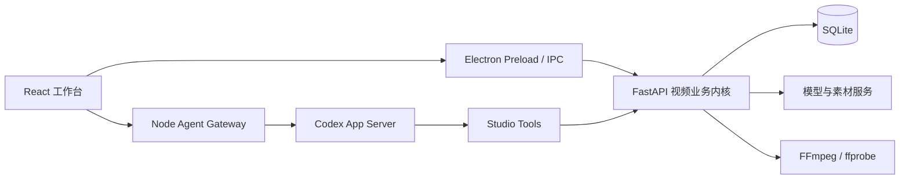

<p align="center">
  
</p>

<h1 align="center">青幕 Lime Studio</h1>

<p align="center">本地优先、Agent 驱动的 AI 口播与短剧创作桌面应用。</p>

<p align="center">
  <a href="https://github.com/JenvinXu/Qingmu_video/actions/workflows/ci.yml"></a>
  <a href="LICENSE"></a>
  
  
  
</p>

青幕把文案、素材、分镜、模型生成、配音、字幕和 FFmpeg 剪辑放在一个桌面工作台内。它通过 Codex App Server 运行本地 Agent，并把作品操作暴露为受约束的工具，让 Agent 能读取当前项目、保存文案和分镜、生成媒体、调整时间线并导出成片。

> 当前版本面向 Windows 10/11。模型调用和公开素材检索需要联网，并由使用者配置自己的服务凭据。

## 主要能力

- **短剧制作**：想法 → 时间轴文案 → 资产配置 → 自动分镜 → 首帧/故事版 → 分镜视频 → 字幕与音轨 → 成片。短剧默认以角色自然对白推进，画外旁白只在需要时使用。
- **口播制作**：想法 → 指定时长文案 → 语义分段 → 视频素材检索与匹配 → AI 补画面 → 配音与字幕 → BGM/音效 → 成片。每个阶段都能单独检查和修改。
- **可控时间线**：分镜按真实时长占位，支持逐镜预览、调整顺序/时长/源视频入点，以及跳过未完成镜头的整片预览。
- **资产库**：角色、物品、图片、视频、声音、配乐和文稿统一管理。参考素材可按分镜绑定，角色与物品只从当前作品选定的资产池中匹配。
- **提示词库**：想法扩写、文案、分镜、资产匹配、故事版、图片和视频提示词均可在界面编辑，保存后直接参与后端任务。
- **模型配置**：文本、图片、视频和音频模型分栏管理。兼容 OpenAI 风格的文本与媒体接口，并带独立视觉模型通道。
- **本地 Agent**：基于官方 Codex App Server 的 stdio JSON-RPC，使用 13 个受约束的 Studio 工具操作当前作品，不向 Agent 开放任意 Shell 或任意文件写入。
- **本地数据**：SQLite 保存项目与配置；媒体文件保存在本机。API Key 使用 Windows DPAPI 加密，渲染进程只能读取“是否已配置”。

## 界面流程

### 短剧

1. **我的想法**：输入一句话，生成包含连续时间段和分镜号的完整剧情文案。
2. **视频文案**：直接修改文案；修改自动保存，分镜数从文案中的分镜标记自动得到。
3. **资产配置**：选择或创建角色、物品、音色、画幅、画质、旁白和配乐。
4. **分镜设置**：Agent 按分镜号原样拆分文案，并从当前资产池匹配角色和物品。
5. **视频制作**：逐镜生成首帧、九宫格故事版和视频，补充图片、声音、视频等参考后在时间线上预览、剪辑和导出。

### 口播

1. **我的想法**：定义主题、受众、目标时长和表达风格。
2. **口播文案**：生成可连续朗读的正文，用户可以直接修改。
3. **画面设置**：按语义和语速拆分片段，建立文案与画面的检索/生成提示。
4. **画面制作**：优先匹配视频素材；匹配度不足时使用 AI 视频补齐，也可只重做选中的片段。
5. **声音字幕**：生成旁白、压缩句间静音并按实际发声时间生成字幕。
6. **视频合成**：混合原声、旁白、BGM 和音效，通过 FFmpeg 输出 MP4。

完整执行细节见 [制作流程文档](docs/current-production-flow.md)，提示词设计依据见 [提示词研究](docs/prompt-research.md)。

## 架构



| 模块         | 目录                                   | 职责                                                 |
| ------------ | -------------------------------------- | ---------------------------------------------------- |
| 桌面壳       | `apps/desktop/`                        | Electron 生命周期、预加载、服务启动与导出对话框      |
| 工作台       | `apps/workbench/src/`                  | React 页面、时间线、素材库、模型与提示词设置         |
| Agent 网关   | `packages/agent/`                      | App Server JSON-RPC 客户端、流式事件和工具 Schema    |
| 视频内核     | `backend/studio/`                      | API、领域模型、工作流、任务、模型适配、素材与 FFmpeg |
| Agent Skills | `agent-skills/`                        | 编剧、视听分镜和视频导演规则                         |
| 测试与脚本   | `tests/`、`backend/tests/`、`scripts/` | 协议、业务回归、启动、验收和打包                     |

## 本地开发

### 环境要求

- Windows 10/11 x64
- Node.js 22+（当前开发环境验证过 Node.js 24）
- Python 3.12
- FFmpeg 与 ffprobe（需加入 `PATH`；当前验证版本为 9.0.1）

### 安装

```powershell
git clone https://github.com/JenvinXu/Qingmu_video.git
cd Qingmu_video

npm ci
python -m venv .venv
.venv\Scripts\python.exe -m pip install --upgrade pip
.venv\Scripts\python.exe -m pip install -r backend\requirements-lock.txt
```

如果 Electron 二进制在 `npm ci` 阶段下载失败，可以临时设置 `ELECTRON_SKIP_BINARY_DOWNLOAD=1` 完成安装，再运行：

```powershell
.venv\Scripts\python.exe scripts\bootstrap-electron.py
```

### 启动

```powershell
npm run dev
```

也可以双击 `启动青幕.cmd`。首次使用时在 **模型设置** 中配置文本、视觉、图片、视频和音频模型。应用不会从仓库读取或提交任何真实 API Key。

公开素材检索可以选择配置这些环境变量：

```powershell
$env:PEXELS_API_KEY = "your-key"
$env:PIXABAY_API_KEY = "your-key"
$env:COVERR_API_KEY = "your-key"
```

未配置第三方素材 Key 时，应用仍可使用本地导入、公开链接、Openverse 和 AI 生成能力。请根据素材来源页面自行核对使用范围和署名要求。

## 构建、测试与打包

```powershell
npm run build
npm run test:agent
npm run test:backend
```

生成 Windows 安装包：

```powershell
npm run package
```

打包流程会构建 Electron 前端、使用 PyInstaller 封装 FastAPI 后端，并加入 FFmpeg 与官方 Codex 运行时。对外分发构建产物前，请同时履行 FFmpeg 构建所含组件的许可证义务，详见 [第三方组件](docs/third-party.md)。

## 模型与 Agent 接入

文本 Agent 使用 OpenAI 兼容的 Responses API；视觉分析使用 Chat Completions 风格的多模态接口。图片、视频和音频适配器与文本配置相互独立。界面支持配置 Base URL、模型名和 Key，因此仓库不绑定特定商业服务。

Agent 可调用的工具包括读取项目上下文、保存文案/分镜、创建角色、分析素材、提取上一镜尾帧、生成单镜/阶段/整片、编辑分镜、排序、绑定资产和导出。所有工具都绑定当前作品，并复用后端领域服务与权限检查。

独立 MCP 入口位于 `scripts/mcp_server.py`。`LIME_BACKEND_URL` 与 `LIME_DATA_DIR` 用于连接已启动的本地实例；桌面应用会自动管理自身所需的内部环境变量。

## 数据与安全

- 开发模式数据位于仓库根目录的 `data/`；发行版数据位于 `%APPDATA%\LimeStudio\workspace\`。
- `data/`、数据库、日志、模型凭据、生成媒体、发行包和本机运行报告均被 `.gitignore` 排除。
- 不要在 Issue、日志或截图中提交 API Key、模型请求原文中的隐私数据或受限制素材。
- 安全问题请按 [安全策略](SECURITY.md) 私下报告。

## 当前边界

- 当前仅支持 Windows，凭据加密依赖 DPAPI。
- 口播支持旁白、字幕和视频画面，还没有虚拟人唇形驱动。
- 短剧效果取决于所选模型对图片、音频、视频参考、时长和分辨率的真实支持范围；后端会在请求前按模型能力校验。
- 素材搜索记录来源与许可证元数据，但使用者仍需负责事实核验、肖像权、版权和商业使用条件。

## 参与贡献

欢迎提交 Issue 和 Pull Request。开始前请阅读 [贡献指南](CONTRIBUTING.md) 和 [第三方组件与归属](docs/third-party.md)。

## 许可证

项目自有代码使用 [MIT License](LICENSE)。`agent-skills/visual-video` 为 CC BY 4.0 改编内容，其他第三方依赖、Skills、素材和随发行包提供的二进制仍遵循各自许可证；详情见 [docs/third-party.md](docs/third-party.md)。
