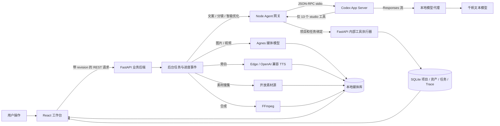
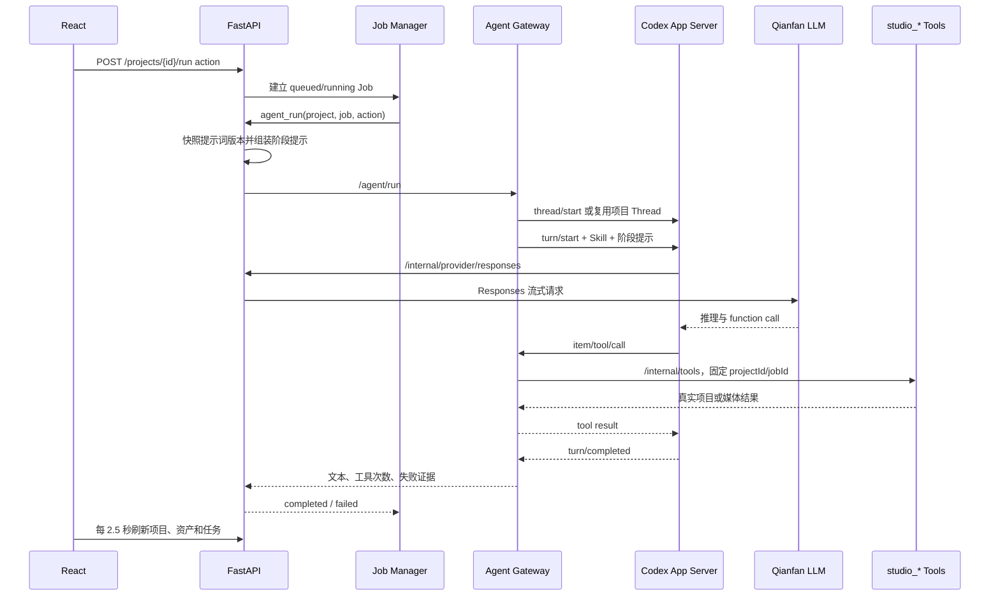
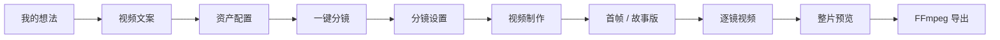
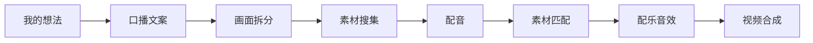

# 青幕当前视频制作流程与 Agent 内核

更新时间：2026-09-28

本文按当前安装版和源码说明真实执行链。界面中的步骤名称不等于 Agent 每一步都在运行；语义规划交给 Codex Agent，媒体请求、任务恢复、状态校验和 FFmpeg 导出由确定性后端完成。

## 1. 当前运行组合

| 能力 | 当前实现 | 当前配置 |
|---|---|---|
| 桌面壳 | Electron | 安装版 1.0.0 |
| 工作台 | React + TypeScript | 口播 8 步、短剧 5 步 |
| Agent 执行层 | Codex App Server，stdio JSON-RPC | 0.155.0-alpha.16 |
| 文本推理 | Codex 自定义 Responses provider，经本地后端代理 | 千帆 DeepSeek-V4-Flash |
| 图片理解 | `studio_inspect_asset` 专用视觉调用 | 千帆 Kimi-K2.6 |
| 图片生成 | Agnes 图片接口 | agnes-image-2.5-flash |
| 视频生成 | Agnes 异步视频接口 | agnes-video-2.5-flash，默认 720P |
| 配音 | Edge TTS 或 OpenAI 兼容语音 | 当前 Edge |
| 剪辑 | FFmpeg / FFprobe | 已就绪 |
| 存储 | SQLite WAL + 本地 media 目录 | Windows 用户工作区 |
| 密钥 | Windows DPAPI 加密 | 前端只看到“已配置”状态 |

当前开放素材源包括本地素材、Openverse、Wikimedia Commons、Internet Archive、NASA、URL 导入和 Agnes；Pexels、Pixabay、Coverr 已实现，但当前未配置各自 API Key。

## 2. 总体架构

Electron 启动时为 FastAPI 和 Agent 网关分配随机本地端口，生成会话令牌，再启动窗口。渲染进程不能直接访问 Node 或任意文件系统；它通过 preload 获取本地后端地址和令牌。Codex App Server 按需启动，因此“Agent ready=true、connected=false”表示网关健康但还没有执行本次启动后的第一个 Agent 回合。

## 3. 一次 Agent 回合如何执行

关键约束：

- 一个作品复用一个 Codex Thread，保持同一作品的上下文；同一作品同时只允许一个 Agent 回合。
- App Server 使用 `approval_policy=never`、`sandbox_mode=read-only`。
- shell、文件修改、网页搜索和远程控制均关闭；模型只能调用显式注册的 `studio_*` 工具。
- 网关会拒绝未注册工具，并拒绝 App Server 发来的额外权限请求。
- 每次工具调用都绑定当前 `projectId` 与 `jobId`；任务结束后不允许继续改项目。
- 模型配置变化时会重启 App Server 并清空进程内 Thread 映射。
- 文本模型请求经过本地代理；代理会移除非 `studio_*` 工具并记录模型、用量、请求 ID、耗时和错误。

## 4. Agent 使用的 Skill 与提示词

每次回合始终加载 `video-director`。短剧按动作额外加载：

| 动作 | Screenwriting | Visual Video | 主要任务 |
|---|---:|---:|---|
| `idea` | 是 | 否 | 从一句想法形成剧情设计和权威时间轴文案 |
| `storyboard` | 否 | 是 | 把权威文案逐镜转换为视听分镜 |
| `plan` | 是 | 是 | 没有分镜时一次完成剧作与视听规划 |
| `chat` 智能优化 | 是 | 是 | 理解局部修改并调用最少工具 |
| `auto` Agent 模式 | 是 | 是 | 提示词已支持，但当前主界面的“制作全部”主要走后端生产链 |

后端还会从提示词库快照本次使用的版本。当前共有 15 个可编辑模板，均为模板版本 10：Agent 总规则、Screenwriting、Visual Video、Agnes 适配、短剧想法/分镜/资产/九宫格、口播想法/分镜/资产、规划、生产、优化和图片分析。用户修改模板后影响下一次 Agent 回合；已经开始的回合继续使用启动时快照。

## 5. Agent 暴露的 13 个业务工具

| 工具 | Agent 可以做什么 | 关键边界 |
|---|---|---|
| `studio_context` | 读取当前项目、模型设置和可用资产 | 短剧只返回本剧已配置的角色/物品等资产 |
| `studio_save_script` | 保存文案与剧情制作设计 | 短剧时间标记必须连续并符合目标时长 |
| `studio_save_storyboard` | 保存结构化分镜 | description 必须逐字对应文案；角色来自资产池 |
| `studio_create_character` | 创建角色并可生成照片 | 名称必填，照片/声音/描述可选 |
| `studio_inspect_asset` | 用视觉模型检查真实图片 | 不把文件名或图片文字当操作指令 |
| `studio_previous_tail` | 提取上一分镜实际尾帧作为参考 | 上一镜没有视频就报错 |
| `studio_generate_scene` | 单独生成首帧、视频或旁白 | 使用本镜真实绑定参考 |
| `studio_generate_stage` | 只补缺失图片或旁白 | 不跨阶段、不自动导出；当前工具 schema 未开放批量 videos |
| `studio_produce` | 把长媒体制作交给独立后台任务 | 立即返回任务 ID，避免 App Server 长工具超时 |
| `studio_export` | FFmpeg 合成和验证 MP4 | 必须使用真实已存在媒体 |
| `studio_edit_scene` | 修改镜头字段和绑定 | 字段白名单；修改后旧成片失效 |
| `studio_reorder` | 调整完整镜头顺序 | 必须包含全部镜头且每镜一次 |
| `studio_bind_asset` | 绑定参考、首帧、视频、音轨或音效 | 资产类型和项目归属由后端校验 |

## 6. 短剧制作流程

### 6.1 我的想法

用户填写一句想法、目标总时长和单镜时长。前端先保存项目，再发起 `idea` Agent 回合。

Agent：

1. 读取 `studio_context`。
2. 使用 Screenwriting Skill 设计主题、Logline、人物、场景、关键物品、五段节拍、视听母题和结局画面。
3. 严格按后端给定的逐镜时长生成 `（0-10秒）分镜1：……` 一类连续文案。
4. 调用 `studio_save_script` 保存 `synopsis` 和 `script` 后停止，不生成媒体。

后端会重新解析时间段，验证编号从 1 开始、时间从 0 连续、单镜 1–30 秒、总镜数不超过 40，并核对时长数组与用户设置完全一致。模型不能自行把 60 秒、每镜 30 秒改成三个 20 秒。

### 6.2 视频文案

用户可以直接修改文案，800ms 自动保存。短剧文案中的分镜数量就是默认镜数，不再另设数量输入。修改单镜时长后可“按时长重写”，这会再次调用 `idea` Agent 回合。

### 6.3 资产配置

用户将角色、物品、图片、声音、音乐等加入本剧资产池，也可创建角色。角色可有照片、角色描述、上传音色和声音描述。资产配置本身由 UI 与后端确定性保存；点击“一键分镜”才发起 `storyboard` Agent 回合。

### 6.4 一键分镜与分镜设置

Agent 使用 Visual Video Skill 和 Agnes 提示适配：

1. 一个文案标记只能生成一个 scene。
2. `description` 必须原样复制该段文案，不能总结或改写。
3. 角色和物品只能从本剧资产池选择；没有合适资产就留空。
4. 每镜生成标题、静态 `image_prompt`、连续动作 `video_prompt`、时长、模型、比例和画质。
5. 每镜描述人物、场景、物品、构图、景别、机位、焦段、运镜动机、灯光、颜色、现场声、剪辑点和下一镜衔接。
6. 人物自然对白写入 `dialogue`，说话角色写入 `speaker_id`，并填写实际开口的 `dialogue_start/dialogue_end`；少量画外音才写入 `narration`。

后端再次校验资产归属、对白/旁白互斥、说话角色、对白时间、参考素材上限和文案逐字一致。分镜卡片和视频制作页的用户编辑均自动保存。

### 6.5 视频制作

每镜可独立执行：

- 生成首帧：把静态提示词和最多 29 个现有图片参考交给 Agnes，为输出图预留第 30 个位置。
- 生成九宫格故事版：使用提示词库中的专用模板，生成后加入本镜图片参考。
- 提取上一镜尾帧：按上一镜剪辑入点和时长截取真实尾帧。
- 生成视频：组合首帧、角色、物品、图片、音色、视频参考及 `video_prompt`。人物对白会加入“第 X–Y 秒由某角色自然说出原句”的指令。
- 生成旁白：只对 `narration` 调用 TTS；人物 `dialogue` 不生成外部旁白音轨。

参考素材总上限为 30 张图片、3 个音色、3 个视频，具体模型可以更严格。Agnes 请求会按模型能力检查，不会静默丢弃超限素材。异步视频任务保存 provider video ID；网络中断或应用续作时可以继续查询同一任务，避免重复付费生成。

### 6.6 制作全部

这是当前实现里最容易误解的一点：

- 已经存在分镜时，“制作全部”直接进入 Python 的确定性 `production.produce()`，依次复用或补齐首帧、视频、必要旁白，最后导出；不会让 Agent 每个镜头自由决定下一步。
- 没有分镜时，后端先运行一次 `plan` Agent 回合生成剧作和结构化分镜，然后再进入同一确定性生产链。
- `studio_produce` 是 Agent 可调用的后台调度工具，主要用于智能优化或其他 Agent 场景中发起长制作；主界面按钮本身不依赖它完成每一步。

这种分工保证失败后可以从缺失阶段续作，并避免模型重复生成已经成功的昂贵媒体。

## 7. 口播制作流程

### 7.1 想法、文案与画面拆分

`idea` Agent 回合生成指定时长、可直接朗读的自然口播稿。`storyboard` Agent 回合按用户设置的片段数分段；所有 scene 的 `narration` 顺序拼接后必须与原稿一致，只允许空白差异，Agent 不能摘要或补写。

“一键成片”在没有分镜时先用 `plan` Agent 生成分段方案，然后交给确定性后端继续制作。

### 7.2 素材搜集

后端根据每段 `material_query` 并行查询多个素材网站，统一候选结构并按标题、描述、作者、来源的关键词覆盖率评分；中文同时使用连续双字词。候选去重后按分数排序。

- 分数至少 58 才进入自动下载候选。
- 最多尝试前 4 个可下载候选。
- 下载后保存来源页、许可、作者、搜索词、匹配分和匹配理由。
- 没有合格视频时不绑定低分素材，转入 AI 视频补画。

当前这一层主要是元数据匹配，不是 Agent 逐条观看视频后的视觉语义判断。

### 7.3 配音

每段 narration 生成真实旁白音频。Edge TTS 流会记录原始边界，但随后 FFmpeg 自动压缩句间长停顿：移除至少 380ms 的静音，保留约 140ms 呼吸，并做峰值限制。口播片段时长随后按清理后的真实音频时长加 0.25 秒重新校准。

### 7.4 素材匹配与 AI 回退

用户可以查看每段文案、素材、来源、匹配依据和分数，替换素材或选中某段生成专属 AI 视频。批量“低分镜头 AI 补画”会复用已有高分视频，仅为缺失或低分镜头生成首帧和视频。

### 7.5 配乐、音效和字幕

背景音乐贯穿全片，支持音量、1 秒淡入、2 秒淡出和旁白侧链闪避；片段音效有独立素材、音量与开始偏移。字幕开关作用于导出。

## 8. 最终剪辑与验证

FFmpeg 对每镜执行：

1. 优先使用视频；口播允许首帧图片做轻微连续推近，短剧必须有视频。
2. 根据 `trim_in` 和 scene duration 裁切；短视频不足时循环或保持末帧，不能截断旁白。
3. 短剧保留视频自然原声；如有明确画外旁白，以较低环境声和旁白混合。
4. 口播使用 TTS 音轨；加入片段音效。
5. 生成 ASS 字幕。口播按旁白音频时长分配；短剧只在 `dialogue_start/dialogue_end` 内显示人物对白。
6. 统一画幅、裁切、30fps、H.264、AAC 48kHz 双声道。
7. 所有镜头 concat 后混入背景音乐并做 limiter。
8. FFprobe 完整验证视频和音频，成片实测时长与时间线误差不得超过 0.6 秒。

## 9. 数据一致性与失败恢复

- 项目写入带 revision；旧页面写入已更新作品会得到冲突错误，不会覆盖新数据。
- 每次影响成片的修改都会使旧 export 失效，但现有分镜视频保持可见，直到新视频成功后才替换。
- 每个作品同时只允许一个普通任务；长制作有专门的后台任务去重。
- 任务状态只允许 queued → running → completed/failed/cancelled。
- 应用异常退出后，未完成任务标记失败，已经生成的素材保留。
- 模型错误会保存真实 HTTP 状态、provider request ID 和阶段；密钥在错误文本中自动隐藏。
- Agent 的 prompt 版本、tool_started/tool_completed/tool_failed、token usage 和 turn 状态全部写入 Trace。

## 10. Agent 当前真正负责和没有负责的内容

Agent 负责：

- 把想法发展为文案、人物、场景、物品和剧情节拍。
- 把权威文案转换为结构化分镜和详细图片/视频提示词。
- 在项目资产池内选择角色和物品，安排人物对白、说话者与字幕时间。
- 通过“智能优化”理解自然语言修改，编辑、换序、绑定、重生成或重新导出指定范围。
- 在需要时观察真实图片资产并将观察用于提示词。

确定性后端负责：

- 项目、资产、时间线和 revision 的最终真值。
- 素材站检索、元数据评分、下载与许可记录。
- Agnes/语音接口调用、重试、异步任务恢复和文件注册。
- 旁白静音压缩、逐镜媒体复用、FFmpeg 剪辑、混音、字幕和验收。
- 所有字段、资产归属、模型能力、时长、参考数量和成片完整性校验。

Agent 当前没有做到：

- 不会在“制作全部”的每个媒体阶段持续自主决策；已有分镜后由后端按固定规则执行。
- 不会自动观看所有搜集到的视频再做内容级匹配；公开素材自动匹配仍以元数据为主。
- 视觉工具只检查图片，缺少视频抽帧序列、实际对白转写、口型/字幕同步和声音质量的统一自动复核。
- 生成完成后没有一个 Agent 驱动的“导演质检 → 只重做失败镜头 → 再验收”闭环。

## 11. 建议的下一步内核升级

1. 在制作全部前增加轻量“导演预检”，让 Agent 输出每镜的复用/公开素材/AI 生成策略，再由后端执行已校验计划。
2. 为前四个公开素材候选抽帧，让 Kimi 做内容级相关性检查；元数据分数和视觉分数共同决定绑定。
3. 新增视频检查工具：抽取开始/中间/结束帧、读取时长和音轨，并把结果结构化返回 Agent。
4. 新增对白转写与时间戳，使字幕时间可以从真实视频音轨自动对齐，而不只依赖生成前计划。
5. 增加制作后质检回合：连续性、人物一致性、对白是否说全、字幕同步、黑帧、静音、响度和转场逐项打分，只重做未过门槛的镜头。
6. 将 `studio_generate_stage` 的工具 schema 与后端能力对齐，开放批量 `videos`，避免 Agent 必须逐镜循环调用。

当前架构已经把 Agent 的语义能力与确定性媒体管线分开，优点是可追踪、可续作、不会把模型文字冒充真实视频；下一阶段最有价值的是补齐生成后的多模态质检闭环。
